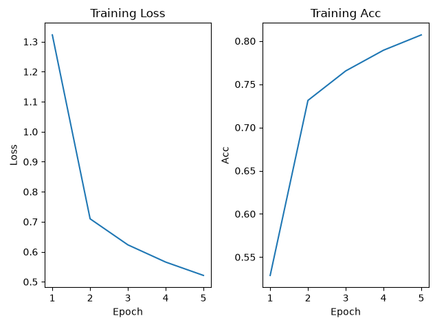

# 01_fashion_mnist_cnn
Fashion-MNIST image classification using a CNN built with PyTorch
# Fashion-MNIST CNN Classification

## Project Introduction
基于CNN 识别Fashion-MNIST 数据集
项目包含模型训练 测试 模型保存与加载以及单张图片的预测

## Dataset
使用 FashionMNIST
训练集 60,000 张图片
测试集 10,000 张图片
每张图片是灰度图，所以 C=1
图片大小 28×28
一共有 10 个类别

## Model Architecture
| Layer          | Output Shape |
|----------------|--------------|
| Input          | 1 × 28 × 28  |
| Conv2d + ReLU  | 6 × 28 × 28  |
| AvgPool2d      | 6 × 14 × 14  |
| Conv2d + ReLU  | 16 × 10 × 10 |
| MaxPool2d      | 16 × 5 × 5   |
| Flatten        | 400          |
| Linear         | 64           |
| Output         | 10           |

## Training
Loss Function：CrossEntropyLoss
Optimizer：SGD
Learning Rate：0.01
Batch Size：64
Epochs：5
Device：GPU

## Results
Final Training Loss:0.5212
Final Training Accuracy:80.7 0
Test Accuracy: 81.31

## Prediction
预测类型:Ankle boot
真实类型:Ankle boot
预测概率:62.66%

## Project Structure